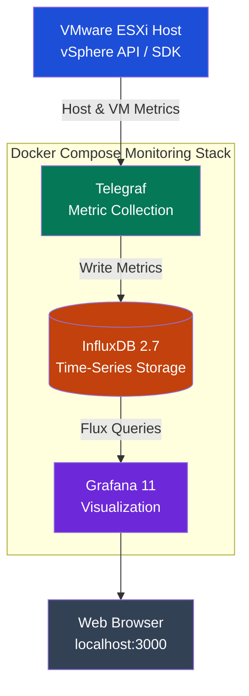

# ESXi Live Monitoring

A Docker-based infrastructure monitoring solution for VMware ESXi, using Telegraf, InfluxDB and Grafana to collect, store and visualize real-time host and virtual machine performance metrics.

<p align="center">
  
  
  
  
  
</p>

## Overview

ESXi Live Monitoring is a portable monitoring stack designed to monitor VMware ESXi infrastructure through a Docker-based environment.

The solution collects infrastructure performance metrics directly from an ESXi host through the vSphere API, stores them in InfluxDB and visualizes them through Grafana dashboards.

The entire monitoring stack is managed using Docker Compose, making deployment and reuse across different ESXi hosts straightforward.

### Key Features

- Direct VMware ESXi monitoring through the vSphere API.
- Automated host and virtual machine metric collection.
- CPU, memory, disk and network performance monitoring.
- Time-series metric storage using InfluxDB.
- Automatic Grafana datasource provisioning.
- Containerized deployment using Docker Compose.
- Persistent storage through Docker volumes.
- Reusable configuration for different ESXi hosts.

## Architecture

The monitoring solution consists of three Docker containers connected through a Docker network.



### Component Responsibilities

| Component | Responsibility |
|---|---|
| VMware ESXi | Provides host and VM performance metrics |
| Telegraf | Collects metrics through the vSphere API |
| InfluxDB | Stores collected metrics as time-series data |
| Grafana | Visualizes infrastructure performance |
| Docker Compose | Orchestrates all monitoring containers |

## Screenshots

### 1. Grafana Monitoring Dashboard

Live infrastructure monitoring dashboard displaying ESXi CPU, memory, disk and network usage.


### 2. Docker Desktop – Running Containers

The monitoring stack running through Docker Desktop, with InfluxDB, Telegraf and Grafana services.


### 3. InfluxDB Data Explorer

Collected vSphere metrics and time-series data available through the InfluxDB Data Explorer.


## Technology Stack

| Technology | Version / Usage |
|---|---|
| VMware ESXi | 7.0 Update 3 |
| Docker Desktop | Container runtime |
| Docker Compose | Container orchestration |
| Telegraf | 1.30 |
| InfluxDB | 2.7 |
| Grafana | 11.0 |
| Windows | Windows 11 Pro |
| VMware Workstation | ESXi virtualized lab environment |

## Metrics Collected

Telegraf uses the vSphere input plugin to collect the following performance metrics.

| Metric | vSphere Metric |
|---|---|
| CPU Usage | `cpu.usage.average` |
| Memory Usage | `mem.usage.average` |
| Disk Usage | `disk.usage.average` |
| Network Usage | `net.usage.average` |
| Power Usage (Host) | `power.power.average` |

Metrics are collected for the ESXi host and virtual machines, subject to the availability of the respective vSphere metrics.

## Repository Structure

```text
esxi-live-monitoring/
│
├── docker-compose.yml
├── .env.example
├── .gitignore
├── README.md
│
├── telegraf/
│   └── telegraf.conf
│
├── grafana/
│   └── provisioning/
│       └── datasources/
│           └── influxdb.yml
│
└── docs/
    ├── architecture.svg
    └── images/
        ├── docker-desktop-containers.png
        ├── grafana-dashboard.png
        └── influxdb-data-explorer.png
```

## Prerequisites

Before deploying the monitoring stack, ensure the following are available:

- Windows 11 or another supported Docker host.
- Docker Desktop with WSL2 backend (Windows).
- VMware ESXi host accessible over the network.
- ESXi account with permission to read performance metrics.
- PowerShell or another command-line terminal.

### Lab Environment

The project was tested using the following environment:

- Host Machine: Windows 11 Pro.
- Hypervisor: VMware Workstation.
- Guest Hypervisor: VMware ESXi 7.0 Update 3.
- Guest Workload: Windows 10 virtual machine.
- Container Platform: Docker Desktop.

## Installation and Deployment

### Step 1: Clone the Repository

```powershell
git clone https://github.com/brij06h/esxi-live-monitoring.git

cd esxi-live-monitoring
```

### Step 2: Configure Environment Variables

Create your local environment file:

```powershell
Copy-Item .env.example .env
```

Open `.env` and configure the following values:

```env
# VMware ESXi Connection
ESXI_HOST=YOUR_ESXI_IP
ESXI_USERNAME=YOUR_ESXI_USERNAME
ESXI_PASSWORD=YOUR_ESXI_PASSWORD

# InfluxDB Configuration
INFLUXDB_USERNAME=admin
INFLUXDB_PASSWORD=YOUR_STRONG_PASSWORD
INFLUXDB_ORG=homelab
INFLUXDB_BUCKET=esxi
INFLUX_TOKEN=YOUR_INFLUXDB_TOKEN

# Grafana Configuration
GRAFANA_ADMIN_USER=admin
GRAFANA_ADMIN_PASSWORD=YOUR_STRONG_PASSWORD
```

Replace the placeholders with your actual credentials.

**Security:** The `.env` file contains sensitive information and must never be committed to GitHub.

### Step 3: Start the Monitoring Stack

Run the following command from the project directory:

```powershell
docker compose up -d
```

Docker Compose will start:

- InfluxDB
- Telegraf
- Grafana

### Step 4: Verify Container Status

```powershell
docker compose ps
```

All three services should be running.

### Step 5: Access Grafana

Open the following URL in your browser:

http://localhost:3000

Log in using the Grafana credentials configured in your `.env` file.

The InfluxDB datasource is automatically provisioned through:

`grafana/provisioning/datasources/influxdb.yml`

### Step 6: Verify Collected Metrics

Open Grafana and select the `InfluxDB-ESXi` datasource.

Use the Flux query editor to inspect the collected ESXi metrics.

Example CPU query:

```flux
from(bucket: "esxi")
  |> range(start: -15m)
  |> filter(fn: (r) => r._measurement == "vsphere_host_cpu")
```

Adjust the bucket and measurement names if your configuration differs.

The InfluxDB Data Explorer can also be used to inspect available measurements and fields.

## Useful Docker Commands

| Command | Description |
|---|---|
| `docker compose up -d` | Start all services |
| `docker compose ps` | Check container status |
| `docker compose logs -f` | View service logs |
| `docker compose logs -f telegraf` | Monitor Telegraf logs |
| `docker compose restart` | Restart services |
| `docker compose down` | Stop and remove containers |
| `docker compose down -v` | Stop containers and remove persistent volumes |

**Note:** Using `docker compose down -v` deletes the stored InfluxDB and Grafana data.

## Reusing the Monitoring Template

The project is designed to be reused with another ESXi host.

To deploy it on another machine:

1. Clone or copy the project folder.
2. Install Docker Desktop or another supported Docker environment.
3. Create a local `.env` file from `.env.example`.
4. Update the ESXi host IP and authentication details.
5. Start the stack using `docker compose up -d`.
6. Access Grafana through `http://localhost:3000`.

The same monitoring architecture and datasource provisioning can be reused without manually configuring the Grafana datasource again.

## Security Considerations

- Never commit `.env` or actual credentials to a public repository.
- Use a dedicated ESXi monitoring account with least-privilege read-only permissions instead of the root account.
- The current lab configuration uses `insecure_skip_verify = true` to accommodate self-signed ESXi certificates.
- For production environments, configure trusted certificates and disable certificate verification bypass.
- Replace default service credentials with strong, unique passwords.
- Use appropriate network restrictions when exposing Grafana and InfluxDB ports.

## Project Scope and Future Improvements

### Implemented

- Docker-based monitoring stack.
- Direct ESXi host connectivity through the vSphere API.
- Automated infrastructure metric collection.
- InfluxDB time-series storage.
- Grafana datasource provisioning.
- CPU, memory, disk and network visualizations.
- Persistent Docker volumes.
- Reusable environment-based configuration.

### Future Enhancements

- Automated Grafana dashboard provisioning using dashboard JSON.
- Grafana alerting and notification integration.
- Multi-host monitoring through VMware vCenter.
- Production TLS and certificate management.
- Additional infrastructure performance metrics.

## Author

**Brijesh Chandera**

GitHub: [@brij06h](https://github.com/brij06h)

---

If you find this project useful, feel free to explore the repository and its implementation.
